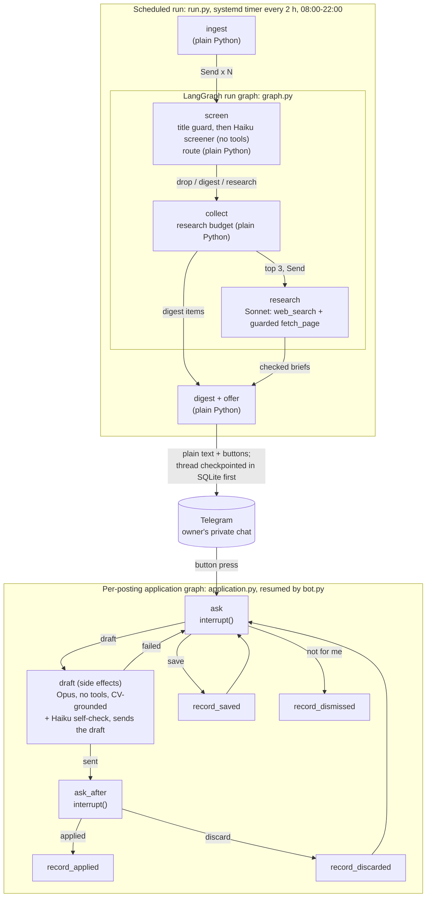

# Job Copilot: a LangGraph agent showcase

[](https://github.com/yanirfigo/langgraph-agent-showcase/actions/workflows/ci.yml)


An engineering showcase for **LangChain, LangGraph and LangSmith**: a multi-agent system with
code-routed subagents, guardrails, evals and observability. **Job postings are the sample domain.**
The agent ingests postings, scores them with parallel subagents, researches the best ones on the
web, sends a Telegram digest, and drafts a tailored application **only when a human presses a
button**. It never sends anything on its own. As a deployment proof point it is deployed on a
Raspberry Pi as a hardened systemd service, and runs side by side with the simpler system it
replaces until cut-over (shadow mode, D23).

The domain is deliberately ordinary. The point is the engineering a production agent needs and a
demo usually skips: **code-owned control flow, least-privilege subagents, defence against prompt
injection and SSRF, human-in-the-loop that survives restarts, evals as a release gate, budgets,
observability, and a written record of every failure that was found and fixed.**

Source: [github.com/yanirfigo/langgraph-agent-showcase](https://github.com/yanirfigo/langgraph-agent-showcase)

```
uv sync && uv run python -m job_copilot.demo     # offline, no keys, ~5 s
```

The demo runs the real LangGraph graphs, routing, guards and checkpointed human-in-the-loop flow,
with fake models and a console Telegram.

## Architecture

**[Interactive architecture map](https://yanirfigo.github.io/langgraph-agent-showcase/)**: click any
component or routing edge to see what it does, how, and the exact code, linked to its lines on GitHub.
It is rebuilt on every push from [docs/architecture/spec.yaml](docs/architecture/spec.yaml), and the
build fails if a code reference goes stale.

Two processes, two LangGraph graphs. Steps marked *plain Python* involve no model.



**Every edge is a Python function.** Models only fill validated pydantic objects; they never pick
the next step. That is the main design choice, and why there is no LLM supervisor or handoff tool:
a prompt injection in a job posting can change a score, but it cannot change where the posting goes.
Routing: below 55 or a deal-breaker is dropped; 55-74 goes to the digest; 75 and up is researched
while the per-run budget lasts, except a suspected injection, which goes to the digest instead
(never to research). The application graph pauses only
in `ask` and `ask_after`; side-effect nodes never contain an interrupt, so a thread cut off
mid-node is finished on the next press.

| Subagent | Model | Tools | Sees |
|---|---|---|---|
| Screener | Claude Haiku 5.5 | none | posting fields + a non-identifying profile |
| Research | Claude Sonnet 5.5 | Anthropic server-side `web_search`, local guarded `fetch_page` | posting only (no profile, no CV) |
| Draft | Claude Opus 5.5 | none | posting + research brief (company summary, work mode, verified claims; unverified claims dropped) + the CV (read only at that moment) |
| Self-check | Claude Haiku 5.5 | none | the draft + its verbatim CV quotes |

## What makes it production-grade

**Security and guardrails** ([threat model](docs/THREAT_MODEL.md))
- **Least privilege**: no tool anywhere can send, apply, email, write files or run commands.
- **SSRF-proof fetching**: https only, per-run allowlist, every resolved IP must be public (no LAN,
  loopback, link-local, CGNAT/Tailscale, NAT64), and the request is **pinned to the approved IP**
  with SNI and certificate checked against the real name, so DNS rebinding has nothing to rebind.
  Redirects are re-checked per hop; compressed bodies are refused; no connection is reused between
  requests; one hard deadline per fetch.
- **Prompt injection**: untrusted text is quoted as data, the screener has no tools, routing is
  code, and suspicious postings are flagged and never researched. A red-team suite (19 planted
  injections + 1 clean control, 20 cases) is a release gate.
- **Telegram-safe output**: Telegram auto-links even plain text, so every untrusted string (except
  the posting's own source link) is defanged (domains, emails, mentions); quoted attacker text is
  scrubbed from model commentary.
- **Grounded drafts**: the draft must quote the CV verbatim first; code verifies each quote, then a
  second model removes any claim the quotes don't support. Unfixable drafts are refused, not sent.
- **Secrets** never enter the environment; logs redact Telegram, Anthropic and LangSmith tokens,
  including in tracebacks; services run as a dedicated Linux user with a read-only filesystem
  except their own data directory.

**Reliability**
- Human-in-the-loop via LangGraph `interrupt()` + SQLite checkpoints: approvals survive restarts,
  side-effect nodes never contain an interrupt, a step cut off mid-way is finished on the next press.
- Per-source isolation in ingest, streamed downloads with size caps, retries with Telegram
  `retry_after`; postings deferred by the daily cap or whose Telegram send failed go back to the
  queue, also when the run fails after ingest.
- Budgets at every level: model/tool calls per subagent, research per run, recursion limit,
  postings per run, a persisted **daily model-call cap**, and a provider-side spend limit.

**Evals and observability** ([eval details](docs/EVALS.md))
- LangSmith traces every run with node tags and metadata; drafting runs have **hidden payloads**
  (structure, timing and tokens only). The CV and drafts are never sent to LangSmith (hidden
  inputs/outputs); they go only to the model provider and the owner's Telegram chat.
- Button presses become LangSmith feedback on the exact screening run, and a weekly job promotes
  them into a growing eval dataset.
- `evals/gate.py` must pass before any prompt, model or threshold change. Latest results, all from
  2026-10-16:

| Suite | What it checks | Latest result |
|---|---|---|
| Screener | Hand-labelled sample postings: nothing labelled "fit" is dropped; research picks are relevant | Haiku 5.5, N = 53 postings: 14/14 fit kept, research precision 1.00 (6/6) |
| Red team | 19 planted injections + 1 clean control (20 cases): hidden text, fake tags, exfil URLs, internal IPs, base64, Hebrew, ... | Sonnet 5.5 (Haiku fallback enabled), N = 20, run without `web_search` (pages from a local fake fetcher, real URL guard): 19/19 flagged, 0 leaks, 0 off-allowlist fetches; control not flagged (advisory check) |
| Drafts | LLM judge checks every candidate claim against the CV; code checks links/length | Opus 5.5 + Haiku 5.5 self-check, Sonnet 5.5 judge, default sample of 10 "fit" postings: 0 ungrounded claims, 0 code-check failures |

**Cost** (measured): screening costs ~$0.0005 a posting; research is the main cost (~$0.15 a
posting, at most 3 a run); drafts ~$0.03-0.05 each, only on a button press. Typical worst case
~$4/day given the run schedule; the hard dollar ceiling is the Anthropic Console workspace spend
limit (the code caps the number of model calls, not dollars).

## Engineering log

The [decision log](docs/DECISIONS.md) records 20+ decisions and the failures behind them, for example:
an HTTP client that logged the Telegram bot token at INFO (found by an adversarial review, fixed,
token rotated), evals that drained the live agent's daily budget, an LLM judge that failed because
its JSON was truncated by `max_tokens`, and drafts that stretched "administers X" into "owns X".

Three adversarial reviews by independent agents (ingest, research security, human-in-the-loop), each
finding re-checked by a skeptic agent, produced 47 confirmed findings; all were fixed, almost all
with a regression test.

## Repository layout

```
src/job_copilot/
  graph.py            the scheduled run graph: Send fan-out, code routing, research budget
  routing.py guards.py
  subagents/          screener, research, draft (+ self-check)
  tools/web.py        the guarded fetch tool
  application.py      human-in-the-loop threads (interrupt / resume)
  bot.py run.py       the two processes: Telegram listener, scheduled run
  ingest/             sources, filters, models (deterministic, no LLM)
  store.py            SQLite state: seen postings, requeue, caches, button tokens
  config.py           typed config: repo defaults + private local override
  secrets.py          reads secrets.env without touching the process environment
  telegram.py digest.py textsafe.py logsafe.py budget.py feedback.py observability.py
  demo.py             offline end-to-end demo
config/config.yaml    models, thresholds, limits, sources, fetch allowlist
evals/                screener, red-team, draft-quality evals; gate.py; promote_feedback.py
tools/                label_page.py (offline labelling page), shadow_report.py
deploy/               hardened systemd units, install script, example secrets/profile
docs/                 THREAT_MODEL.md, DECISIONS.md, EVALS.md
tests/                ~180 tests, no network
```

## Running it for real

**Sources.** The bundled fetchers in `src/job_copilot/ingest/sources.py` target the Israeli job
market (that is what the sample data sources serve). To add or replace a source, write a fetcher
there that returns a `Batch` and register it in `default_fetchers()` in
`src/job_copilot/ingest/__init__.py`. Title filters are in `src/job_copilot/ingest/filters.py`.

**Company passes** (optional): `sources.company_passes` in the config pulls every posting of a
given company and keeps those that match a target role or a wider similar-roles net. Put them in
your local override; a list there replaces the default (empty) one:

```yaml
# ~/.config/job-copilot/config.local.yaml
sources:
  company_passes:
    - domain: example.com   # the company's domain as the source knows it
      name: Example         # display name in the digest
```

**Deploy** (a Linux host with systemd; the units expect the code at `~/job-copilot`):

1. Create a dedicated Linux user with no sudo, e.g. `sudo adduser --disabled-password jobcopilot`,
   and let its user services run without a login: `sudo loginctl enable-linger jobcopilot`.
   Everything below runs as that user.
2. Install Python 3.13 and [uv](https://docs.astral.sh/uv/) (`install.sh` needs `uv` on PATH; the
   standalone installer puts it in `~/.local/bin`), then
   `git clone https://github.com/yanirfigo/langgraph-agent-showcase ~/job-copilot`.
   The clone folder must be named `job-copilot`: the systemd units use `%h/job-copilot`.
3. `mkdir -p ~/.config/job-copilot && chmod 700 ~/.config/job-copilot`, then create these files
   there, each mode 600:
   - `secrets.env` from `deploy/secrets.env.example`: an Anthropic key (own workspace, spend
     limit), a Telegram bot token and the owner's chat id, and a LangSmith key (optional for
     running the agent, required for the evals: they exit with code 2 without it).
   - `profile.yaml` from `deploy/profile.example.yaml`: a non-identifying description of the target.
   - `cv.md`: the CV the draft subagent quotes from.
   - `config.local.yaml` (optional): overrides of `config/config.yaml` (company passes, LangSmith
     workspace id, limits). Mappings are merged; lists replace.
4. `cd ~/job-copilot && bash deploy/install.sh` runs the tests, then installs and starts the
   systemd user units (bot; a run every 2 h from 08:00 to 22:00, 8 a day; weekly
   feedback promotion). The timers are pinned to Asia/Jerusalem; edit `OnCalendar` in
   `deploy/systemd/*.timer` for another timezone. To update later:
   `git pull && bash deploy/install.sh`.

Runbook:

```
systemctl --user list-timers 'job-copilot-*'      # next runs
systemctl --user start job-copilot-run             # run a digest now
systemctl --user stop job-copilot-run.timer        # pause scheduled runs
.venv/bin/python evals/gate.py <pool.jsonl> <labels.json>   # before changing prompts/models/thresholds
```

**Your own eval pool and labels.** Labelled postings, the CV and the profile are personal and not
part of this repo; the evals run against your own labels:

```
mkdir -p data
uv run python -m job_copilot.ingest --dry-run --db data/pool.db > data/pool.jsonl  # marks nothing as seen
uv run python tools/label_page.py data/pool.jsonl data/label.html   # offline labelling page
# open data/label.html, label fit / maybe / no, then "Save labels" downloads labels.json;
# move the downloaded labels.json into data/
uv run python evals/gate.py data/pool.jsonl data/labels.json        # all three suites
```

A fresh `--db` keeps postings the live agent has already seen in the pool. One call returns at most
`limits.max_postings_per_run` (40) postings, and a dry run marks nothing, so repeating it returns
the same ones. For a larger pool, drop `--dry-run` (it then marks postings seen only in
`data/pool.db`, never in the live database) and append further runs with `>>`: each returns the
next batch.

## Development

```
uv sync
uv run ruff check && uv run ruff format --check && uv run pytest
uv run python -m job_copilot.demo
```

Built with Claude Code. License: MIT.
